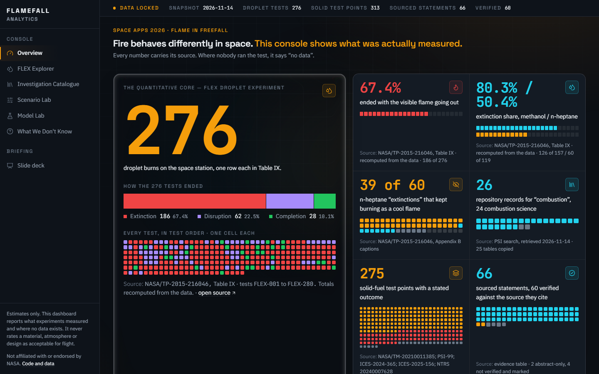
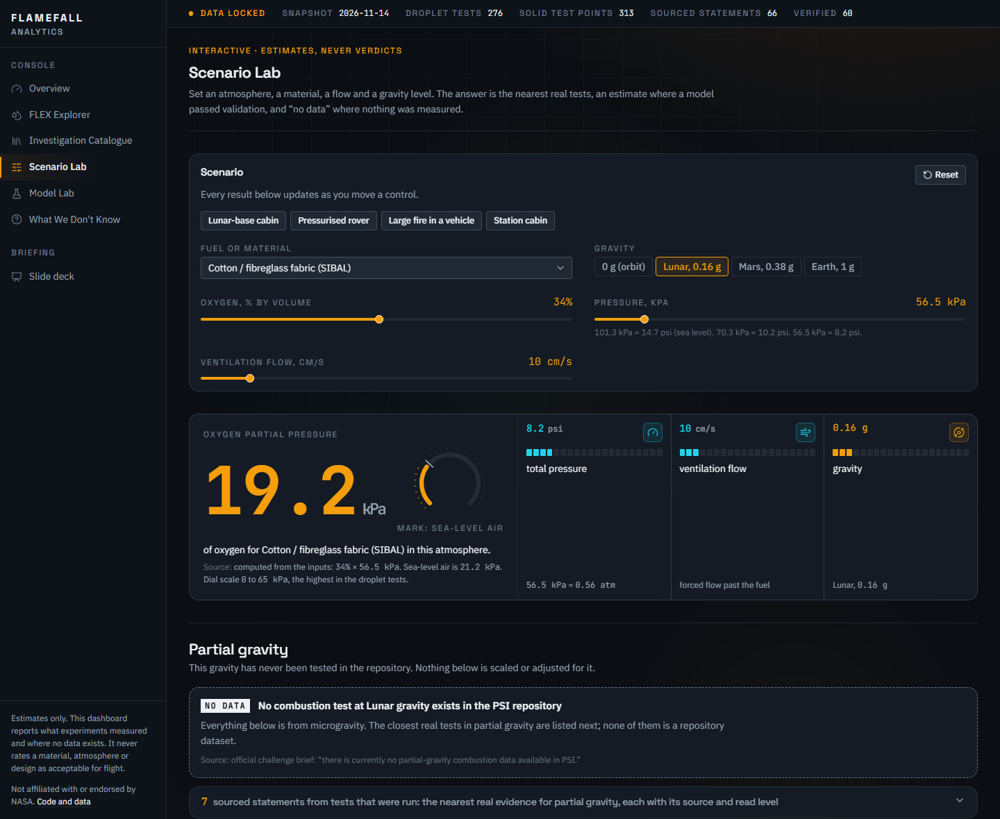

# Flamefall Analytics

**What microgravity combustion experiments actually measured, for people designing crewed
spacecraft, stations, surface habitats and pressurised rovers.**

Space Apps Challenge 2026 · *Flame in Freefall: SI-Powered Fire Safety Insights from Microgravity
Combustion Data* · team Flamefall Analytics.

- **Live console, hosted on Render:** https://flamefall-analytics.onrender.com
- **Slide deck (7 slides):** https://flamefall-analytics.onrender.com/deck/



The project summarises, ranks and interprets combustion investigations from NASA's Physical
Sciences Informatics (PSI) repository. Three rules hold throughout:

1. **Every number carries its source**: report, table, page and test number.
2. **"No data" is an answer.** Where nobody has run the test (partial gravity, for example) that is
   stated, with the nearest real tests. A gap is never filled by guessing.
3. **No verdicts.** Outputs are measurements and estimates with stated uncertainty. Nothing here
   rates a material, atmosphere or design as acceptable for flight.

## What the data shows

Each number below is recomputed from the data files by the tests (`tests/test_docs.py`).

| Finding | Number | Source |
|---|---|---|
| FLEX droplet burns on the space station | 276 tests: 186 Extinction, 62 Disruption, 28 Completion | NASA/TP-2015-216046, Table IX |
| Fuel matters as much as atmosphere | Extinction in 126 of 157 methanol tests and 60 of 119 n-heptane tests | Same table |
| "No visible flame" is not "fire out" | 39 of 60 n-heptane extinctions show evidence of cool-flame burning afterwards | Same report, Appendix B captions |
| Repository search for "combustion" | 26 records, 24 of them combustion science, 25 experimental tables | PSI Data Repository |
| Solid-fuel test points | 313 transcribed, 275 with a stated outcome; the highest oxygen among them is 31.9% | NASA/TM-20210011385, PSI-99 and four papers |
| Widest oxygen range reported by a solid-fuel investigation that has flown | 13 to 34% (SoFIE-GEL, extinction limits mapped over that range). The data files hold no solid-material test point above 34% | Range: T'ien et al., Combust. Flame 277 (2025) 114244. Points: `data/solid_test_points.csv` |
| Combustion tests in lunar or Martian gravity in the repository | 0 | Official challenge brief; PSI search |
| Sourced statements | 66, of which 60 were verified against the source they cite | `data/evidence.json` |

Three small models were fitted, each on one kind of evidence, and reported as they scored on
groups they had never seen:

| Model | Rows | Score (ROC-AUC) | Used for estimates? |
|---|---|---|---|
| Droplet: does the visible flame go out? | 275 | 0.88 grouped cross-validation, 0.74 on an unseen fuel (the headline) | Yes, in microgravity only, with distance to data |
| Droplet: cool-flame evidence | 47 | 0.75, exploratory, one fuel only | As a sketch, labelled |
| Solid: is the flame sustained? | 179 | 0.48, no better than chance | No. Reported as a failure |

## The six pages

| Page | Question it answers |
|---|---|
| [Overview](https://flamefall-analytics.onrender.com/) | What was measured, in a few numbers |
| [FLEX Explorer](https://flamefall-analytics.onrender.com/flex/) | What happened in each of the 276 droplet burns? |
| [Investigation Catalogue](https://flamefall-analytics.onrender.com/catalogue/) | Which experiments matter for my vehicle? |
| [Scenario Lab](https://flamefall-analytics.onrender.com/scenario/) | What is the nearest real test to my scenario? |
| [Model Lab](https://flamefall-analytics.onrender.com/models/) | How far can a model be trusted here? |
| [What We Don't Know](https://flamefall-analytics.onrender.com/unknowns/) | Where does the data stop? |



## How it is put together

| Layer | Where | What it does |
|---|---|---|
| Data and models | `flamefall/`, `scripts/`, `data/` (Python) | Loads and checks the source tables, builds the catalogue, fits and validates the models |
| Export | `scripts/export_web.py` | Writes everything the web app reads as JSON, plus reference answers for its tests |
| Web app | `web/` (Next.js App Router, shadcn/ui, Recharts, Motion, react-countup) | Six pages and the slide deck, exported as a static site and hosted on Render |

Python runs at build time only. The web app never opens a CSV and never fits a model. Moving
between pages, or changing a filter, happens in the browser with no page reload.

## Run the web app

```bash
cd web
npm ci
npm run dev
```

Tests, lint and the production build, from the same folder:

```bash
npm run test
npm run lint
npm run build
```

## Rebuild and check the data

```bash
python -m venv .venv
source .venv/bin/activate        # Windows: .venv\Scripts\activate
python -m pip install -r requirements.txt
python scripts/build_flex_droplets.py
python scripts/export_web.py
```

Tests, in the same activated environment:

```bash
python -m pip install pytest
python -m pytest
```

## What is in the repository

| Path | What it is |
|---|---|
| `web/` | The web app: pages in `src/app/`, components in `src/components/`, calculations in `src/lib/`. See [web/README.md](web/README.md) |
| `web/src/data/`, `web/public/psi/` | The exported JSON the app reads (written by `scripts/export_web.py`) |
| `flamefall/` | Data loading, schema rules, aggregates, catalogue, triage formula and models |
| `data/flex-table-ix.csv` | 276 FLEX droplet-burn tests from NASA/TP-2015-216046, Table IX |
| `data/flex_caption_annotations.csv` | Per-test cool-flame, support and extinction wording from the same report's figure captions |
| `data/flex_droplets.csv` | The same tests in the normalised 24-column research schema |
| `data/psi/`, `data/bass2/` | The PSI repository snapshot and the BASS-II tables |
| `data/solid_test_points.csv` | Every solid-fuel test point, with its outcome and whether its pressure is stated or assumed |
| `data/evidence.json`, `data/panels.json` | Sourced statements and small curated tables |
| `data/models/` | Stored model cards |
| `data/PROVENANCE.md` | Where each file came from, cleaning rules, how to re-check it |
| `scripts/` | Extraction, verification, build, training and export scripts. See [scripts/README.md](scripts/README.md) |
| `tests/` | Totals recomputed from the data; schema rules (a) to (e); export checks; wording rules |
| `docs/` | SI disclosure, human spot-check list, submission text. See [docs/README.md](docs/README.md) |
| `DECISIONS.md` | Assumptions, and corrections found by checking primary sources |
| `QUESTIONS.md` | Open items that need a human |
| `CONTRIBUTING.md` | The rules a change must keep, and how to check it |
| `render.yaml` | How the site is built and published on Render |

## Data sources

- **FLEX**: Dietrich et al., *Detailed Results From the Flame Extinguishment Experiment (FLEX) March
  2009 to December 2011*, NASA/TP-2015-216046, Nov 2015. https://ntrs.nasa.gov/citations/20150023456
  (PSI record PSI-69).
- **BASS-II**: the BASS-II summary memo, NASA/TM-20210011385. https://ntrs.nasa.gov/citations/20210011385
- **PSI Data Repository, combustion science**: https://psi.nasa.gov/physci/repo/search?q=combustion
- **Papers and presentations**, cited per statement with a quote and a page in `data/evidence.json`.

The FLEX report and the BASS-II memo are primary sources found by the builder; they are not links
on the challenge's Resources tab. Full details are in `data/PROVENANCE.md`.

## Re-check the core dataset yourself

```bash
curl -L -o flex.pdf https://ntrs.nasa.gov/api/citations/20150023456/downloads/20150023456.pdf
pip install pymupdf
python scripts/verify_flex_table_ix.py flex.pdf
```

The script rebuilds Table IX from the PDF with a different library than the one used for the
original extraction and compares every cell with the CSV.

## Use of SI tools, and what has not been checked by a person

The research notes, the code, the data pipeline, the console and the slide deck were produced with
SI tools directed by the team. Inside the console there is no generative model: it uses retrieval
over sourced statements, a stated formula with visible weights, and small validated classifiers.
The full disclosure is in [docs/SI_DISCLOSURE.md](docs/SI_DISCLOSURE.md).

Two limits are stated plainly:

- The checks against primary sources were run by the SI coding agent with scripts anyone can
  re-run. The list of spot-checks for a person is in
  [docs/HUMAN_VERIFICATION.md](docs/HUMAN_VERIFICATION.md), with its status.
- The code was reviewed by an SI review bot in its early rounds and by SI reviewer agents after
  that (`DECISIONS.md`, D42). No person has reviewed it.

## Licence and branding

MIT licence (see `LICENSE`). The project uses publicly released NASA data. It is not affiliated
with or endorsed by NASA and uses no NASA logos, insignia or mission marks. The liquid-glass surface on
the Overview is adapted from Sera UI (MIT licence, copyright Sera UI); the notice is in
`web/src/components/ui/liquid-glass.tsx`.
